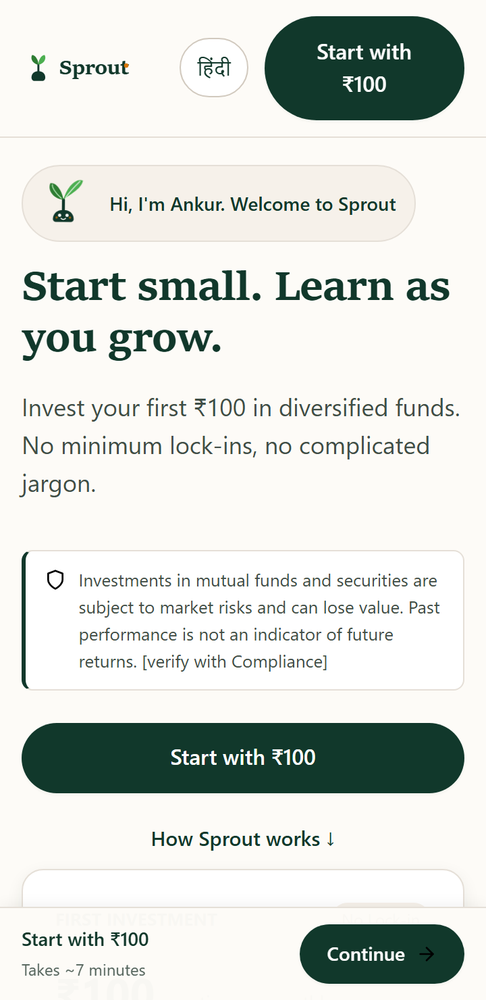
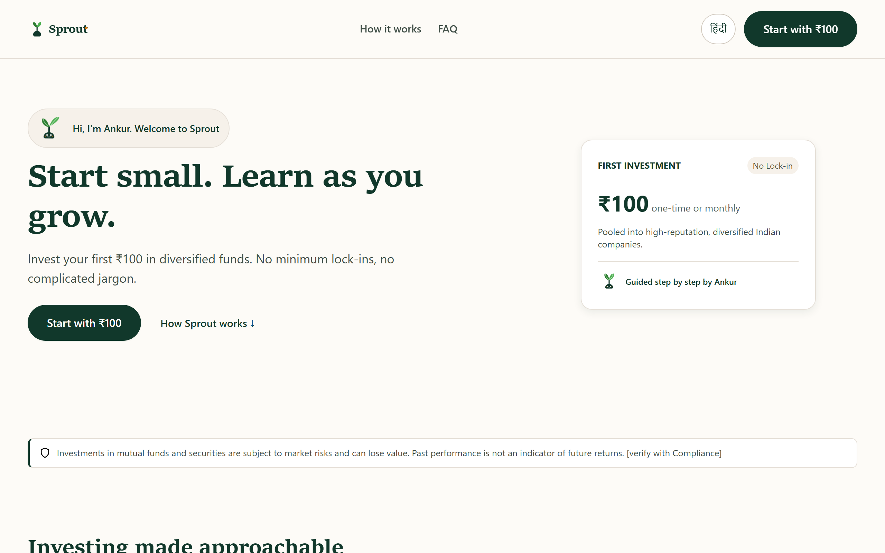
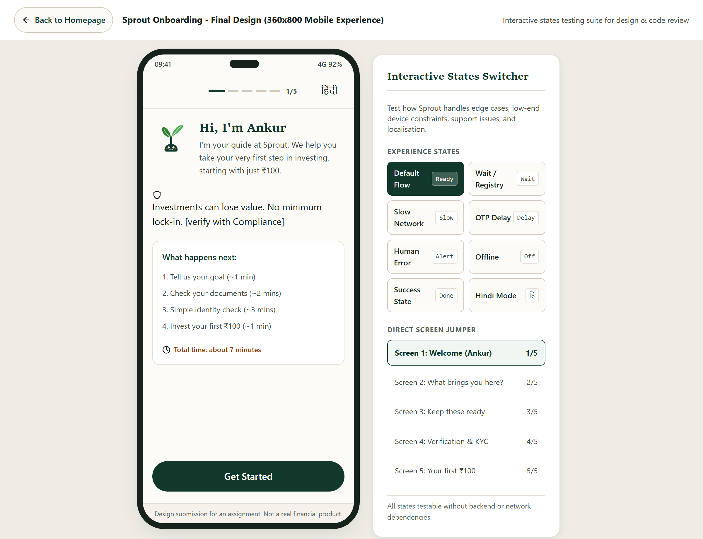

# Sprout 2.0: Product Design & Strategy Case Study
**Designing an Accessible, Trust-First Investing Journey for New Investors in India**

*Author: Senior Product & Front-End Designer*  
*Project: Sprout 2.0 Overhaul*  
*Date: October 2026*  

---

## 1. TL;DR: The Three Biggest Decisions

1. **Reconciled the Broken KYC Funnel Beyond the Form Itself**  
   The brief reported a 62% drop-off at the KYC step, but reconciling the absolute numbers revealed that **~41% of downloaders (roughly 16,300 people) never reached KYC at all**, while another **14,700 abandoned mid-verification**. Instead of treating KYC as an isolated form problem, I redesigned the pre-KYC experience on both website and app: introducing an upfront "Keep these ready" preparation screen (resolving Customer Support's top complaint) and setting predictable time expectations before users touch sensitive documents.

2. **Resolved the Executive-Marketing Impasse with a Restrained Mascot Architecture**  
   Marketing demanded a cartoon mascot, video, live ticker, and three pop-ups to drive viral engagement; the CEO insisted on an Apple-like minimal interface with zero cartoons to protect investor trust. I broke the deadlock by designing **"Ankur" (Hindi for sprout)**: a geometric, flat seedling that acts as a quiet, respectful companion at moments of emotional friction (such as verification wait states), but is strictly banned from appearing near legal risk disclaimers, high-stress errors, or promotional pop-ups. Marketing's live ticker was cut entirely to prevent market anxiety, pop-ups were eliminated, and the video was converted into a lightweight, click-to-load poster.

3. **Engineered Hard Compliance and Low-End Performance Baselines**  
   With 91% of users on mobile and 40% on smartphones under ₹10,000 [brief data point, assuming sub-₹10k entry smartphone segment] facing 6.2-second average 4G loads [brief-cited unverified baseline], heavy JavaScript frameworks were rejected. The entire website and onboarding app is vanilla HTML/CSS/JS with zero external CDN dependencies, self-hosted system fonts with native Devanagari support, and sub-3 KB inline SVGs. Measured homepage payload is **87.3 KB** (well under the 400 KB target and 1.5 MB ceiling). Every screen featuring investment content presents a regulatory risk disclaimer rendered at **13px** (exceeding the 12px legal minimum) visible in the first viewport without scrolling.

---

## 2. Problem & Funnel: Mathematical Reconciliation

### The Reported Data
- Total App Downloads: **40,000**
- Completed KYC: **9,000** (22.5% of total downloads)
- Made First Investment: **3,000** (7.5% of total downloads; 33.3% of KYC-completed users)
- Post-KYC Leakage: **66.7%** of verified users do not invest.
- Reported KYC Drop-off: **62%**

### Reconciling the Numbers (Inference)
The brief states a 62% drop-off at the KYC step. If 62% of users who *reached* KYC abandoned it, then the completion rate among KYC starters was:
$$\text{Completion Rate} = 100\% - 62\% = 38\% \quad (0.38)$$

If 9,000 users successfully completed KYC, the implied volume of users who reached the KYC entrypoint is:
$$\text{Users Reaching KYC} = \frac{9,000}{0.38} \approx 23,684 \quad (\text{roughly } 23,700)$$

This derivation reveals two distinct failure points:
1. **At-the-Step Abandonment:** About $23,700 - 9,000 = 14,700$ users initiated KYC but abandoned before completion.
2. **Pre-KYC Leakage:** About $40,000 - 23,700 = 16,300$ downloaders (**40.8% ≈ 41%**) abandoned the app before ever encountering the KYC step.

> [!NOTE]
> **Analytical Note:** This calculation assumes that the 62% drop-off rate and the 40,000 / 9,000 cohort figures represent the same measurement period. I have documented this as an inference. Before production release, product analytics must confirm exact step-by-step event conversions (`app_open` $\to$ `screen1_view` $\to$ `screen2_view` $\to$ `screen3_prep_view` $\to$ `kyc_start` $\to$ `kyc_complete` $\to$ `order_confirm`).

```
40,000 Total Downloads
 │
 ├── 16,300 (40.8%) dropped before KYC entrypoint [Addressed by Screen 1 & 2 clarity]
 │
 └── 23,700 reached KYC step
      │
      ├── 14,700 (62.0%) abandoned during KYC [Addressed by Screen 3 prep & Screen 4 wait state]
      │
      └── 9,000 completed KYC
           │
           ├── 6,000 (66.7%) leaked without investing [Addressed by Screen 5 ₹100 default]
           │
           └── 3,000 made first investment (7.5% of downloads)
```

---

## 3. What the Data Does and Does Not Say

### 1. Bounce Rate (78%) is Contaminated
The 78% homepage bounce rate was measured over a 2-week period that coincided with a paid acquisition ad campaign. Paid ad traffic frequently brings low-intent visitors with misaligned expectations. **What the data does NOT say:** It does not tell us the organic baseline bounce rate.  
*Action:* Marketing and Analytics must segment bounce rate by traffic acquisition channel (Organic Search, Direct, Paid Social, Referrals) before treating 78% as an operational baseline.

### 2. KYC Drop-off Cause is Statistically Unknown, but Contextually Evidenced
The quantitative telemetry reports a 62% drop-off but fails to log drop-off reasons. However, qualitative customer support logs provide two vital clues:
- *"I didn't know I needed my PAN and Aadhaar ready."*
- *"The app asked me to wait and I thought it crashed."*

*Hypotheses & Instrumentation Plan:*
1. **Unprepared Documents:** Users hit the PAN/Aadhaar prompt, don't have cards in hand, exit the app, and forget to return. *Instrumentation:* Log time-on-screen for Screen 3 and track click rate on "Remind me later".
2. **Registry Latency Mistaken for Crash:** UIDAI/government registry verification latency [assumed 30–60 seconds based on typical KYC gateway SLAs] causes users to force-quit. *Instrumentation:* Track exit timestamps against registry response latency.
3. **Low-End Hardware Failure:** Camera crashing during document scan or slow 4G timeouts. *Instrumentation:* Track network socket error codes and device RAM telemetry.
4. **Distrust of PAN Collection:** Reluctance to share tax IDs on an unfamiliar app. *Instrumentation:* Track click-through on the privacy and regulatory consent disclosures.

### 3. Device & Connectivity Realities
- **91% Mobile, 40% on Devices < ₹10,000 [Brief Baseline, Assumed Entry Segment]:** Budget Android handsets (working archetype: entry devices with 2GB to 3GB RAM, such as Redmi 9A or Realme C-series [assumed ~₹7,499–₹8,999 segment]) operate with low single-core CPU speeds.
- **6.2s Average Load on 4G [Brief Baseline]:** Heavy single-page frameworks (React/Vue with 300KB+ runtime bundles) stall main-thread parsing on budget chipsets.
*Design Response:* Absolute rejection of heavy JavaScript frameworks, client-side hydration, and uncompressed assets.

### 4. Localisation Demand is Directional ("Many" Prefer Hindi)
"Many" is not a metric. However, in Tier-2/3 India, digital financial literacy is heavily constrained by English terminology. Rather than waiting for a full localization mandate, Sprout is architected with complete string extraction (`en.json`, `hi.json`) and tested with a functional Hindi toggle on the document preparation screen.

### 5. Survey (n=40) Suffers from Survivorship Bias
While 65% of respondents stated "Investing feels scary", all 40 participants were *existing active users*. They represent survivors who managed to overcome the initial fear.  
*Action:* Recommend conducting structured 30-minute interviews with **5 to 8 churned users** who dropped off at the KYC step to uncover unspoken emotional blockers.

### What I Would Measure First: Success Metrics Table

| Metric | Current Baseline | 90-Day Target | Measurement Methodology |
| :--- | :---: | :---: | :--- |
| **Organic Homepage Bounce Rate** | 78% (contaminated) | **< 48%** | Segmented Google Analytics 4 / PostHog by UTM medium. |
| **Pre-KYC Drop-off Rate** | ~41% (16,300 users) | **< 20%** | Funnel tracking: `app_open` $\to$ `prep_complete`. |
| **KYC Step Drop-off** | 62% (14,700 users) | **< 35%** | Funnel tracking: `kyc_initiated` $\to$ `kyc_approved`. |
| **Post-KYC First Investment Leak**| 66.7% (6,000 users) | **< 30%** | Conversion rate from `kyc_approved` $\to$ `first_order_settled`. |
| **Total Downloads to Investor** | 7.5% (3,000 users) | **> 18%** | End-to-end cohort conversion over 30 days. |
| **Support Tickets: "App Crashed"** | Baseline volume | **-70% reduction** | Customer support ticket tagging in Zendesk / Freshdesk. |

---

---

## 4. Target Personas [Explicitly Labelled as Research Assumptions]

> [!IMPORTANT]
> **Methodological Disclosure:** These personas are **unvalidated design assumptions** formulated from Tier-2/3 market realities and customer support inquiry patterns. They represent working archetypes that must be formally validated through structured qualitative interviews with 5 to 8 churned users.


### Persona Archetypes Summary
1. **Rohit Verma (23, Junior ITI Technician, Bhopal) — Assumption 1:**
   - *Hardware & Context:* Budget Android [Assumed working archetype: Redmi 9A, ~₹7,499, 2GB RAM] on prepaid 4G. Hindi primary speaker.
   - *Anxiety:* Earns ₹18,000/month; fears digital fraud and believes investing is only for wealthy metro elites.
   - *Drop-off Cliff:* Unexplained loading spinners cause him to believe the app crashed or compromised his data.
   - *Design Response:* Native Hindi toggle, "Keep ready" prep screen, steady wait state mascot, 87.3 KB ultra-lightweight page weight.

2. **Priya Nair (20, College Student, Kochi) — Assumption 2:**
   - *Hardware & Context:* Budget Android [Assumed working archetype: Realme C21, ~₹8,999, 3GB RAM]. English and Malayalam speaker.
   - *Anxiety:* Has ₹100–300 saved from monthly pocket money. Intrigued by financial literacy videos but intimidated by jargon.
   - *Drop-off Cliff:* Abrupt demand for PAN and Aadhaar without an explanation of purpose.
   - *Design Response:* Screen 2 "I'm just curious" entry, explicit regulatory consent card, ₹100 pre-selected default.

3. **Ananya Sharma (27, Operations Associate, Jaipur) — Assumption 3:**
   - *Hardware & Context:* Budget Android [Assumed working archetype: Samsung Galaxy M04, ~₹8,499, 3GB RAM]. English and Hindi speaker.
   - *Anxiety:* Cautious saver; fears sudden penalties or lock-ins preventing her from withdrawing emergency money.
   - *Drop-off Cliff:* Inability to verify whether funds can be liquidated instantly.
   - *Design Response:* Prominent "No minimum lock-in" badge, transparent portfolio breakdown, ₹100 micro-investing.

---

## 5. Usability Test Plan (Empirical Validation Protocol)

To validate whether the Sprout 2.0 interface eradicates the evidenced customer support complaints and pre-KYC leakage, the following empirical test protocol is established:

### Test Parameters
- **Cohort:** 6 participants (3 English primary, 3 Hindi primary).
- **Inclusion Criteria:** First-time investors (0 prior mutual fund folios), owning smartphones under ₹12,000, accessing via mobile 4G.
- **Format:** 45-minute moderated remote or lab session using the Think-Aloud protocol on physical Android handsets.

### Core Evaluative Tasks
1. **First-Impression & Risk Comprehension (Homepage):**
   - *Prompt:* "Look at this page for 15 seconds. In your own words, what is this app, how much do you need to start, and can you lose money?"
   - *Target:* Immediate comprehension of ₹100 threshold and market risk notice without scrolling.
2. **Goal Selection & Expectation Setting (Screens 1 & 2):**
   - *Prompt:* "Start the process. Choose what matches your intention."
   - *Target:* Seamless navigation through the 7-minute expectations card with zero hesitation.
3. **Document Readiness & Fallback (Screen 3):**
   - *Prompt:* "You arrive at this screen, but you realize your physical PAN card is in another room. What do you do?"
   - *Target:* Spontaneous discovery and use of the "Remind me later" permission drawer without abandoning.
4. **Verification Latency & Error States (Screen 4):**
   - *Prompt:* "Enter your details and press verify. The screen is now loading."
   - *Target:* Zero participants force-quitting or stating "the app crashed" during the animated registry wait state [using an assumed 45-second duration guideline based on typical verification turnaround].
5. **First Investment Settlement (Screen 5):**
   - *Prompt:* "Review your starting order and complete the action."
   - *Target:* Confidence in order placement without fear of hidden recurring debits.

### Quantitative Success Benchmarks
- **Task Completion Rate:** $\ge 85\%$ across all 5 screens without moderator intervention.
- **Document Prep Comprehension:** $\ge 90\%$ understanding why PAN/Aadhaar are required.
- **Crash Perception Reduction:** **0%** of participants believing the app crashed during registry wait states.
- **Single Ease Question (SEQ):** Average score $\ge 6.2 / 7.0$ across all completed flows.

---

## 6. Product Design Principles

1. **Honesty Over Hype**  
   Never promise guaranteed returns, never display synthetic growth tickers, and never use artificial countdown timers. Financial trust is built when an app is candid about market risks.
2. **One Job Per Screen**  
   New investors experience cognitive overload when confronted with multi-input forms. Each screen has a single purpose, a clear progress indicator, and an unmistakable primary action.
3. **Respect for Low-End Hardware**  
   Design for the user on an entry-level smartphone [assumed sub-₹10,000 segment with 2GB RAM] on an intermittent 4G connection. Every millisecond of latency is an invitation to abandon.
4. **Human Guidance Without Condescension**  
   Acknowledge that financial fear is normal. Never blame the user for system errors, failed document lookups, or network drops.

---

## 7. Stakeholder Negotiation Table

| Stakeholder | What Was Asked | What is Valid | My Call as Designer | Trade-off / Compromise Rationale |
| :--- | :--- | :--- | :--- | :--- |
| **CEO** | "Minimal, Apple-like, no cartoon characters. Investors won't trust a cartoon." | Financial apps must convey institutional credibility and stability; childlike cartoons undermine serious trust. | **The mascot stays, but as a restrained geometric seedling.** Calm, grounded vector; flat colors; no 3D, no sparkles. | Humanizes cold financial onboarding without feeling like a children's game. Prohibited from appearing near legal risk text. |
| **Head of Marketing** | Mascot, video, live ticker, 3 pop-up modals, and referral banner. | Social proof, clear product demonstration, and viral referral loops are proven acquisition levers. | **Cut the ticker and all pop-ups.** Video converted to a click-to-load poster. Referral placed as a quiet footer strip and after first investment. | Tickers induce anxiety for beginners; modals cause immediate mobile abandonment. Click-to-load video saves 4G data. |
| **Compliance Officer**| Risk disclaimer $\ge$12px visible without scrolling in first viewport. Banned terms: "guaranteed", "safe", "risk-free". | Regulatory mandates under SEBI are non-negotiable; violations risk platform suspension. | **Implemented 13px disclaimer component in the first viewport** across all investment screens. Automated copy linter runs in CI. | Disclaimer placed right below the primary CTA so users see risk transparency immediately before acting. |
| **Lead Developer** | Page weight $<1.5\text{ MB}$, CSS animations only, 1 front-end engineer for 3 weeks. | A single engineer cannot build complex state engines or debug heavy animation libraries within 21 days. | **Pure vanilla HTML/CSS/JS with zero build step.** System fonts with Devanagari fallback; total payload is **87.3 KB**. | 3-week delivery plan with strict cut list protects engineering sanity and guarantees lightning performance. |
| **Customer Support Lead** | Complaints: "Didn't know I needed documents ready" and "Thought app crashed during wait". | Unprepared users drop off permanently; blank loading spinners look like software deadlocks. | **Added "Keep these ready" prep screen** and an animated 45-second wait state with reassurance text. | Directly targets and eliminates the two largest evidenced sources of user friction and support churn. |

---

## 8. End-to-End User Journey Map

The journey map below traces the emotional transition of a first-time investor from initial skepticism upon seeing an ad to confident ownership of their first ₹100 portfolio.


### Design Responses by Journey Stage
1. **Ad Encounter:** Avoided hyperbolic claims; ad links directly to a plain-language landing page with pre-set parameters.
2. **Homepage Landing:** Replaced complex market data with an interactive 4-step vertical roadmap mirroring the app.
3. **Intent Confirmation (Screen 2):** Allowed users to declare "I'm just curious", removing pressure to make immediate financial commitments.
4. **Document Preparation (Screen 3):** Provided an explicit checklist with a "Remind me later" option that defers push notification permissions until needed.
5. **Verification Wait (Screen 4):** Displayed a calm Ankur mascot with an honest 45-second countdown and clear guidance that users can background the app without losing progress.
6. **First Investment (Screen 5):** Pre-selected ₹100 as the starting default, paired with a subtle botanical sprout animation rather than cheap gamified confetti.

---

## 9. Homepage Design Decisions

The homepage is structured as a five-stage narrative: **Fear $\to$ Understanding $\to$ Small First Step $\to$ Trust $\to$ Action.**




1. **First Viewport Architecture (Zero-Scroll Disclaimer Compliance):**
   - Compact brand header with an instant language toggle (`EN | हिंदी`).
   - One headline devoid of jargon: *"Start small. Learn as you grow."*
   - Primary CTA: *"Start with ₹100"* accompanied by Ankur waving in a small 44px badge.
   - Compliance Risk Disclaimer: Rendered in high-contrast text (`#3F4E46` on `#FFFFFF`, 8.78:1 ratio) at **13px**, strictly exceeding the 12px legal threshold and fully visible on both a 360px mobile viewport and desktop without scrolling (top offset 418.8px).
2. **Three Reassurance Anchors:**
   - *Start with just ₹100:* Validates that small amounts matter.
   - *See what you own:* Promises complete portfolio transparency.
   - *Help in your language:* Reassures users that non-English speakers will not be left behind.
3. **Four-Step Vertical Journey:**
   - Step 1: Tell us your goal (~1 min)
   - Step 2: Keep documents ready (~2 mins)
   - Step 3: Simple verification (~3 mins)
   - Step 4: Invest your first ₹100 (~1 min)
   - Uses the **exact same terminology and time estimates** as the onboarding stepper to create zero cognitive rupture when transitioning from web to app.
4. **Static Illustrative Example (No Promised Growth):**
   - Clearly badged: *"Example only, not a prediction"*.
   - Explains how ₹100 is split across index funds, government bonds, and emerging companies. Contains no hypothetical 15% return curves that mislead first-time buyers.
5. **Trust Placeholders & Native `<details>` FAQ:**
   - Regulated credentials clearly marked with `[verify with Compliance]` tags.
   - Accessible accordions answer essential barrier questions: *"What do I need to start?"* and *"Why does verification take time?"*.
6. **Mobile Sticky Action Bar:**
   - Stays pinned to the bottom of the viewport on mobile devices (`<768px`) with safe-area inset padding (`env(safe-area-inset-bottom)`), ensuring it never covers body content or the legal disclaimer.

---

## 10. Onboarding Rationale Per Screen

The onboarding flow runs in a 360x800 viewport with an external States Switcher to test edge cases.



### Screen 1: Welcome ("Hi, I'm Ankur")
- **The Job:** Introduce the companion, establish what Sprout is, and outline the exact roadmap and time commitment (~7 minutes).
- **Mascot Pose:** `ankur-waving.svg` (friendly single wave).
- **Compliance:** Regulatory risk text visible in the first viewport.
- **Primary Action:** *"Get Started"*.

### Screen 2: Intent Discovery ("What brings you here?")
- **The Job:** Understand user motivation without interrogating them.
- **Mascot Pose:** `ankur-thinking.svg` (curious leaf tilt).
- **Choices:** 
  1. *Building a rainy day fund*
  2. *Learning how investing works*
  3. *Saving for a specific goal*
  4. *I'm just curious*
- **Psychological Note:** Includes a warm reassurance banner: *"It is completely normal to feel unsure when starting. We take things one step at a time."*

### Screen 3: Document Preparation ("Keep these ready")
- **The Job:** Directly eliminate Customer Support's #1 complaint (*"I didn't know I needed documents ready"*).
- **Mascot Pose:** `ankur-checklist.svg` (holding document clipboard).
- **Checklist:** PAN Card, Aadhaar-linked phone for OTP, and bank account details, explaining *why* each is mandated by government tax and security laws.
- **De-escalation Action:** A prominent *"Remind me later"* secondary button opens a privacy-friendly drawer. Notification permission is requested *only* here, never on first app launch.
- **Hindi Demonstration:** Includes an active language toggle to prove Devanagari script layout stability.

### Screen 4: Verification & Edge States
- **The Job:** Conduct paperless identity verification while preventing users from thinking the app has crashed.
- **Sub-stepper:** Phone & OTP $\to$ PAN Details $\to$ Aadhaar e-KYC.
- **Consent Pre-condition:** Explicit consent checkbox and privacy disclosure before capturing sensitive identification numbers.
- **Wait State Handling:** If registry checks take 30-60 seconds, the screen transitions to `ankur-reassured.svg` with an animated progress bar and explicit copy: *"You do not need to stare at this screen. If the agency registry is slow, we will save your progress and notify you via SMS when complete."*
- **Error State Handling:** Specific, respectful messaging: *"We couldn't verify this PAN. Please double-check for typos or ensure the name matches your official documents."* Never blames the user.

### Screen 5: The First ₹100 Investment
- **The Job:** Prevent the 66.7% post-KYC leakage by removing investment inertia.
- **Amount Selector:** Pre-selected to ₹100 (with ₹250, ₹500, and Custom buttons).
- **Risk Plain Words:** Explicit disclosure that market investments fluctuate and balance can decrease.
- **Restrained Celebration:** On confirmation, Ankur displays a tiny botanical bud growth animation (`sprout-grow-in`). No loud casino sounds or childish confetti that cheapen real money.
- **Next Small Step:** Clarifies that order units will reflect within 2 business days and offers a gentle referral credit link.

---

## 11. Mascot Architecture & Rules: "Ankur" (अंकुर)

### Visual Anatomy
- **Material:** Pure SVG vector code under 3 KB per file. Flat 3-4 palette colors: Forest Green (`#11382B`), Sprout Green (`#2E7D32`), Soft Leaf (`#4CAF50`), and Marigold (`#D97706`).
- **Style:** Geometric seedling. Expressions communicated solely through leaf angles and eye curves. Zero gradients, zero sparkles, zero 3D rendering.

### Poses & Emotional Mapping
1. `ankur-neutral.svg`: Balanced leaves; resting state.
2. `ankur-waving.svg`: Right leaf raised in welcoming greeting.
3. `ankur-thinking.svg`: Slight leaf tilt; curiosity without confusion.
4. `ankur-checklist.svg`: Holding document clipboard; organized preparedness.
5. `ankur-reassured.svg`: Grounded posture with breathing halo; reassurance during wait states.
6. `ankur-celebrating.svg`: Subtle upward perky hop; golden leaf flourish.
7. `favicon.svg`: 24x24 geometric brand icon.

### Strict Negative Rules (Where Ankur Must NEVER Appear)
- **Never Beside Risk Disclaimers:** Placing a smiling mascot next to legal risk warnings trivializes financial danger and creates compliance exposure.
- **Never on User Error States:** When verification fails or an invalid OTP is entered, Ankur must not appear crying, frustrated, or disappointed.
- **Never as a Blocking Modal:** Ankur is an ambient companion, never a disruptive pop-up character.

---

## 12. Measured Accessibility, Performance & Compliance Results

All metrics reported below were generated through automated scripts executed in the local repository environment.

### 1. Color Contrast Audit (`tools/contrast-check.js`)
- **Total Color Pairs Evaluated:** 18
- **WCAG AA Pass Rate (>= 4.5:1 text, >= 3.0:1 UI):** **100% (18/18 PASS)**
- **WCAG AAA Compliance:** **72% (13/18 PASS)**
- Primary Text (`#18221D`) on Cream (`#FDFBF7`): **15.80:1** (WCAG AAA)
- Primary Text (`#18221D`) on Card White (`#FFFFFF`): **16.33:1** (WCAG AAA)
- Secondary Text (`#3F4E46`) on Cream (`#FDFBF7`): **8.50:1** (WCAG AAA)
- Primary Button (`#FFFFFF` on `#11382B`): **12.92:1** (WCAG AAA)
- Terracotta Error Text (`#9C3218` on `#FDF1EE`): **6.58:1** (WCAG AA)

### 2. Asset Weight Audit (`tools/weight-check.js`)
- **Homepage Total Transferred Weight:** **87.3 KB** (89,347 bytes)  
  *Budget: 1.5 MB limit; Target: 400 KB.* **Passed at 21.8% of target budget.**
- **Onboarding App Screens Total Weight:** **112.3 KB** (114,969 bytes)  
  *Budget: 1.5 MB limit.* **Passed at 7.5% of maximum budget.**
- **External Network Requests:** **0** (Zero CDN calls, zero Google Fonts lookups).

### 3. Automated Accessibility Audit (`tools/a11y-check.js` & `tools/test-subpath.js`)
- **Axe-Core Automated WCAG 2.1 AA Checks:** **0 violations** across Mobile Homepage (360px), Desktop Homepage (1280px), and Onboarding Screens (1 to 5).
- **Automated Scripted Keyboard Navigation:** Validated via headless Playwright Tab-order sequence (`tools/test-subpath.js`), verifying focus ring visibility, logical tab order, and interactive actuation.
- **Manual Screen-Reader Testing:** *Not conducted.* Automated tools verify markup, DOM hierarchy, and contrast, but cannot replace live testing with assistive technologies (TalkBack, NVDA, VoiceOver) with human participants. This is formally listed under Section 16 "Not verified".
- **Tap Targets < 44px:** **0** across all audited viewports.
- **Horizontal Overflow:** **0 px** across all audited viewports.

### 4. Regulatory Copy Audit (`tools/copy-lint.js`)
- **Prohibited Marketing Claims Detected:** **0** (Scanned for guarantee/guaranteed, safe/safer, risk-free, assured, sure-shot, no-risk, can't lose, and Hindi सुरक्षित across all HTML, CSS, JS, JSON, and SVG files).
- **Disclaimer Font Floor:** Verified at **13px** (`0.8125rem`), safely above the 12px legal minimum.
- **First-Viewport Visibility:** Verified true across all investment screens without scrolling.

---

## 13. Localisation Architecture (English & Hindi)

### Devanagari Accommodations
1. **Font Metric Stacks:** Uses system humanist typography with Devanagari companions:
   ```css
   font-family: system-ui, -apple-system, BlinkMacSystemFont, "Segoe UI", Roboto, "Noto Sans Devanagari", sans-serif;
   ```
2. **Expansion Tolerance:** Hindi translations typically require **25% to 35% more horizontal width** than English. Buttons use `min-width: auto; padding: 0.75rem 1.25rem;` with flexible wrapping to prevent text truncation.
3. **Line Height Clearance:** Set to `1.55` - `1.65` to prevent upper matras (`ी`, `े`, `ै`, `ं`) and lower matras (`ु`, `ू`, `ृ`) from clipping.
4. **Natural Financial Hindi:** Translated with simple, conversational phrasing rather than rigid literal translations (e.g. using *"शुरू करने से पहले ये चीज़ें तैयार रखें"* instead of awkward machine syntax). *Note: Flagged for final review by certified financial localization specialists.*

---

## 14. Realistic 3-Week Engineering Plan & Cut List

*Resource constraint: 1 Front-End Developer for 3 Weeks.*

```
WEEK 1: Foundations & Homepage
├── Day 1: Design tokens (tokens.css), reset, system font stack, color contrast audit
├── Day 2: SVG asset library integration (Ankur poses, icons, illustrations)
├── Day 3: Homepage mobile layout (360px viewport, hero, first-viewport disclaimer)
├── Day 4: Homepage desktop layout (1280px, 2-column hero, reassurance grid)
└── Day 5: Interactive language switcher (strings.js) and click-to-load video poster

WEEK 2: Onboarding Stepper & Edge States
├── Day 6: Screen 1 (Welcome) and Screen 2 (Intent selection with accessible fieldset)
├── Day 7: Screen 3 (Document checklist & "Remind me later" permission drawer)
├── Day 8: Screen 4 (KYC sub-stepper, consent checkbox, input form validation)
├── Day 9: Screen 4 State Machine (45s wait state, OTP delay, human error, offline banner)
└── Day 10: Screen 5 (Amount selector, risk warning, restrained botanical celebration)

WEEK 3: Hardening, Accessibility, QA & Deployment
├── Day 11: Keyboard navigation, focus visible rings, touch target validation (>= 44px)
├── Day 12: Automated test suite (copy lint, contrast, weight, axe a11y)
├── Day 13: Localisation review and Devanagari layout stress-testing at 320px/360px
├── Day 14: Headless screenshot generation and Vercel clean URL configuration
└── Day 15: Cross-browser QA (Chrome, Safari, Firefox, Edge, Android WebView) & launch
```

### The Strict Cut List (What Was Cut & Why)
1. **Cut: Live Market Ticker**  
   *Why:* Real-time websocket data feeds consume battery, increase payload, add compliance risk, and trigger acute anxiety in first-time investors during market dips.
2. **Cut: Automatic Modal Pop-ups (Marketing's 3 Modals)**  
   *Why:* Aggressive modals on mobile browsers obstruct the primary user path, cause immediate bounce, and frustrate first-time users.
3. **Cut: Autoplay Video Stream**  
   *Why:* Would consume substantial mobile data [assumed 5–10 MB estimate for an auto-played 720p video on budget mobile data plans]. Replaced with an 18 KB SVG poster that only loads on explicit user interaction.
4. **Cut: Complex Confetti / Physics Animations**  
   *Why:* Confetti trivializes real financial capital. Replaced with a lightweight, 600ms CSS botanical seedling growth animation.
5. **Cut: Heavy Third-Party Analytics SDKs during Initial Launch**  
   *Why:* Prevents main-thread blocking on budget mobile hardware (assumed working archetype: budget Android with 2GB RAM, e.g. Redmi 9A at ~₹7,499) and data leakage. To be replaced with lightweight privacy-first server-side event tracking post-launch.

---

## 15. Metrics & Experimentation (A/B Testing Plan)

### Proposed Post-Launch A/B Tests
1. **Experiment 1: Document Prep Screen vs Direct KYC Entry**  
   - *Hypothesis:* Showing Screen 3 ("Keep these ready") will reduce KYC drop-off by 15% because users won't abandon mid-flow looking for cards.  
   - *Variant A:* Direct entry from Screen 2 to Screen 4 (control).  
   - *Variant B:* Intermediate Screen 3 prep checklist (treatment).  
   - *Primary Metric:* KYC completion rate (`kyc_approved` / `kyc_start`).
2. **Experiment 2: Pre-selected ₹100 vs Open Numeric Input**  
   - *Hypothesis:* Pre-filling ₹100 as the primary button will increase post-KYC first-investment conversion by 20% by reducing decision fatigue.  
   - *Variant A:* Empty input field requiring typing.  
   - *Variant B:* ₹100 pre-selected button chips.  
   - *Primary Metric:* Conversion from KYC approval to order submission within 24 hours.
3. **Experiment 3: Click-to-Load Video Walkthrough vs Static Narrative**  
   - *Hypothesis:* Providing an optional 60-second video walkthrough will decrease bounce rate among paid traffic visitors by 8%.  
   - *Primary Metric:* Time on homepage and scroll depth past Section 3.

---

## 16. Assumptions, Risks & Questions for Stakeholders

### Assumptions Log

| # | Assumption | Risk if False | Validation Action & Timeline | Owner |
| :- | :--- | :--- | :--- | :--- |
| **A1** | Users abandon KYC because they don't have physical documents nearby. | Drop-off might be driven by fear of sharing tax data rather than physical absence. | Run 5-8 drop-off interviews during Week 1 of launch. | Product Design |
| **A2** | ₹100 is low enough to eliminate first-time deposit hesitation. | Users may perceive ₹100 as "not worth investing" or fear hidden account opening charges. | Test messaging: "Zero opening fees, invest what you spend on tea." | Product Marketing |
| **A3** | Hindi is the primary regional language required for Tier-2 pilot. | Target demographic in western/southern states might prefer Marathi, Tamil, or Telugu. | Instrument language preference telemetry on app download. | Data Engineering |
| **A4** | Registry delays average 45-60 seconds [assumed based on typical KYC gateway SLAs]. | Government portal outages can exceed 5 minutes, triggering drop-off despite wait state. | Implement asynchronous SMS fallback if wait exceeds 90 seconds. | Lead Developer |

### Unverified Compliance & Accessibility Items
1. `[verify with Compliance: Registered with SEBI as Mutual Fund Distributor ARN-XXXXX]`
2. `[verify with Compliance: Bank-grade 256-bit encryption for all identity documents]`
3. `[verify with Compliance: Regulated depository partner for automated clearing]`
4. `[verify with Compliance: Exact risk disclosure wording and scheme document links]`
5. `[verify with Legal: Explicit Aadhaar e-KYC consent language and privacy notice URL]`
6. **Manual Screen-Reader Testing:** While automated Axe-core checks (0 violations) and a scripted headless keyboard Tab test (`tools/test-subpath.js`) were executed and verified, manual assistive technology testing with live screen readers (Android TalkBack, Windows NVDA, iOS VoiceOver) with real human subjects has not been conducted.

### Questions I Would Ask Each Stakeholder
- **To the CEO:** *"If we prove through user testing that Ankur increases verification completion without diminishing brand prestige, will you support retaining him across product touchpoints?"*
- **To the Head of Marketing:** *"Can we agree that acquiring 1,000 users who actually invest ₹100 is more valuable than driving 10,000 ad bounces with sensational tickers?"*
- **To the Compliance Officer:** *"Is placing the 13px risk disclaimer directly below the primary hero CTA acceptable, or does legal precedent require it pinned above the fold in a persistent banner?"*
- **To the Lead Developer:** *"Does our zero-framework architecture allow your team to ship the complete 5-screen flow within the 3-week sprint without overtime?"*
- **To the Customer Support Lead:** *"What is the exact percentage of tickets that cite missing documents versus failed OTP delivery?"*
